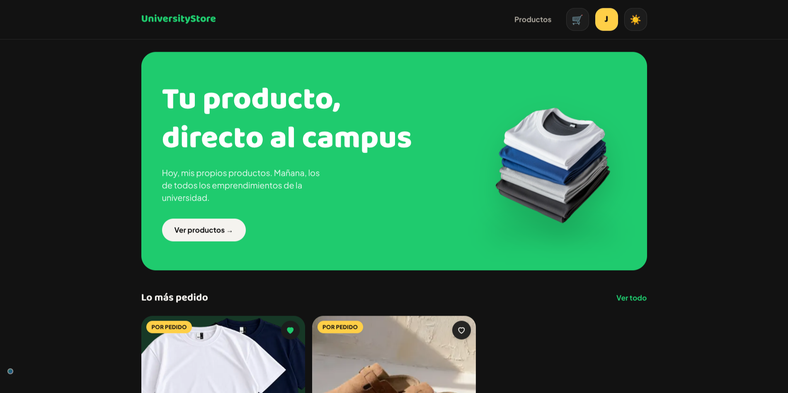

<div align="center">

# 🛍️ UniversityStore

**El marketplace de los emprendimientos universitarios** — hoy, mi propia tienda vendiendo mis productos. Mañana, la plataforma donde cualquier emprendimiento de la universidad pueda publicar los suyos.


<br>



</div>

<br>

## 📑 Contenido

- [El problema, en una escena](#-el-problema-en-una-escena)
- [La solución](#-la-solución)
- [Qué hace (roadmap)](#-qué-hace-roadmap)
- [Instalación y uso](#-instalación-y-uso)
- [Cómo está construido](#-cómo-está-construido)
- [Recursos útiles](#-recursos-útiles)
- [Licencia](#-licencia)
- [Autor](#-autor)

---

## 🎬 El problema, en una escena

Quería vender mis propios productos con una estética distinta a la de un ecommerce genérico: algo juvenil, disruptivo e interactivo, con la energía visual de un sitio de agencia (GSAP, Three.js, scroll-driven, 3D). El punto de partida era el combo clásico de ese tipo de sitios: Webflow + GSAP + Three.js + Lenis + Blender.

El problema es que la visión real no termina en "mi tienda". Es que cualquier emprendimiento de la universidad pueda publicar sus propios productos — un marketplace multi-vendedor. Y Webflow Ecommerce está pensado para una sola tienda: sin cuentas de vendedor, sin dashboards, sin reparto de pagos entre varios emprendimientos. Migrar eso más adelante significaría reconstruir todo de cero.

**UniversityStore** arranca directamente en código: mismo ADN visual que ese combo de agencia, pero sobre una base (Next.js + Supabase) que puede crecer de tienda personal a plataforma sin tirar nada a la basura en el camino.

## 💡 La solución

```text
Catálogo (Supabase) → Tienda personal (Next.js) → Checkout (Stripe) → Marketplace multi-vendedor
```

Cada fase se construye sobre la anterior — la tienda de hoy ya es la base de datos y el código del marketplace de mañana, no un prototipo descartable.

## ✨ Qué hace (roadmap)

**Fase 0 — Fundamentos**
- [x] Paleta y tipografía definitivas (verde + amarillo, Baloo 2 + Plus Jakarta Sans — estética bold inspirada en apps como Rappi)
- [x] Setup de Next.js + Tailwind + Supabase
- [x] Modo claro y modo oscuro
- [x] Hero animado con GSAP + Lenis (foto de producto con fondo removido, no modelo 3D)

**Fase 1 — Tienda personal / MVP**
- [x] Catálogo de productos (listado + detalle) conectado a Supabase, con categorías y filtro
- [x] Diseño responsive / mobile-first
- [x] Carrito de compras (persistido en localStorage, agregado rápido desde la grilla)
- [x] Checkout real con Stripe (falta cargar las claves de API para que procese pagos de verdad)
- [x] SEO básico (metadata, OG tags por producto, sitemap, robots.txt)

**Fase 2 — Comunidad y descubrimiento (en progreso)**
- [x] Cuentas de usuario (registro con confirmación por mail, página de cuenta)
- [x] Favoritos (corazón en cada producto, página `/favoritos`)
- [x] Reseñas y calificaciones de producto (1–5 estrellas + comentario)
- [x] Categorías con filtro en el catálogo
- [ ] Historial de pedidos

**Fase 3 — Marketplace multi-vendedor (visión final)**
- [ ] Onboarding de vendedores (verificación estudiantil)
- [ ] Dashboard de vendedor (productos, ventas, inventario)
- [ ] Pagos divididos con Stripe Connect
- [ ] Buscador y filtros por categoría/facultad/precio
- [ ] Mensajería comprador-vendedor y moderación

Mapa completo con la decisión de stack y la dirección de diseño: [ROADMAP.md](ROADMAP.md).

## 🔧 Instalación y uso

```bash
git clone https://github.com/Juanma-Alvarado/UniversityStore.git
cd UniversityStore
npm install

cp .env.local.example .env.local   # completar con las credenciales del proyecto de Supabase
npm run dev
```

Abrir [http://localhost:3000](http://localhost:3000).

## 🏗️ Cómo está construido

| Capa | Tecnologías |
|---|---|
| Frontend | Next.js (App Router) + TypeScript + Tailwind CSS v4 |
| Datos y cuentas | Supabase (Postgres + Auth + Row Level Security) |
| Pagos | Stripe Checkout |
| Diseño | Baloo 2 + Plus Jakarta Sans · paleta verde / amarillo · modo claro y oscuro |
| Motion | GSAP + Lenis (scroll suave, hero animado) |

```text
src/app/              → rutas: home, /productos, /productos/[slug], /carrito, /ingresar, /cuenta, /favoritos, /api/checkout
src/components/       → componentes de UI (ProductCard, Header, FavoriteButton, ProductReviews…)
src/lib/              → clientes de Supabase/Stripe, sesión, carrito, favoritos y acceso a datos
supabase/migrations/  → esquema de la base, versionado
public/products/      → fotos de producto
docs/                 → imágenes del README
ROADMAP.md            → mapa completo del proyecto (fases, stack, diseño)
```

## 📚 Recursos útiles

- [Roadmap completo del proyecto](ROADMAP.md)
- [Documentación de Next.js](https://nextjs.org/docs)
- [Documentación de Supabase](https://supabase.com/docs)
- [Documentación de Stripe Checkout](https://docs.stripe.com/checkout/quickstart)
- [Referencia de dirección de diseño — Rappi Colombia](https://www.rappi.com.co/)

## 📄 Licencia

MIT — ver [LICENSE](LICENSE).

## 👤 Autor

**Juan Manuel Alvarado**
[GitHub](https://github.com/Juanma-Alvarado) · [Portfolio](https://juanma-alvarado.github.io/PortafolioWeb)
